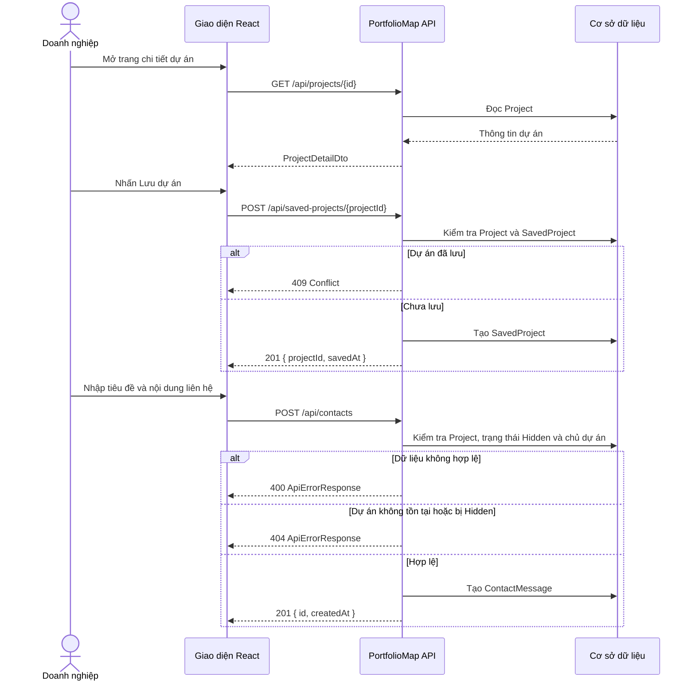
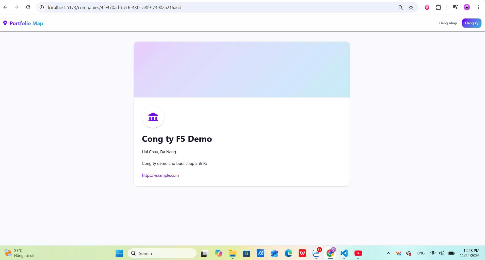
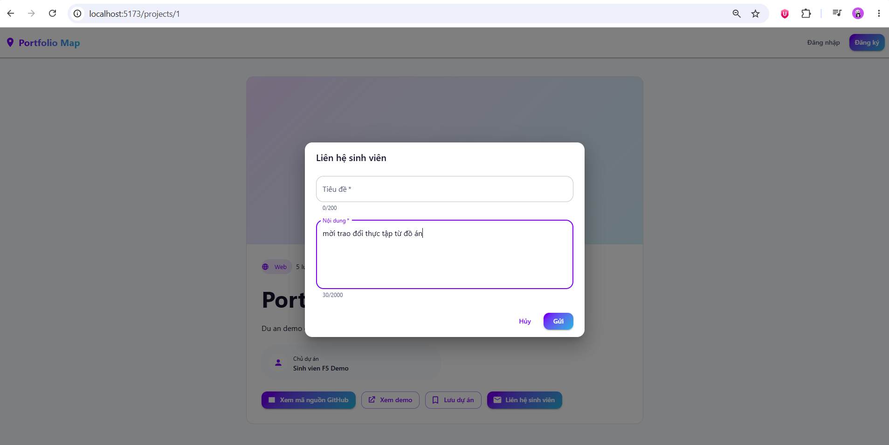
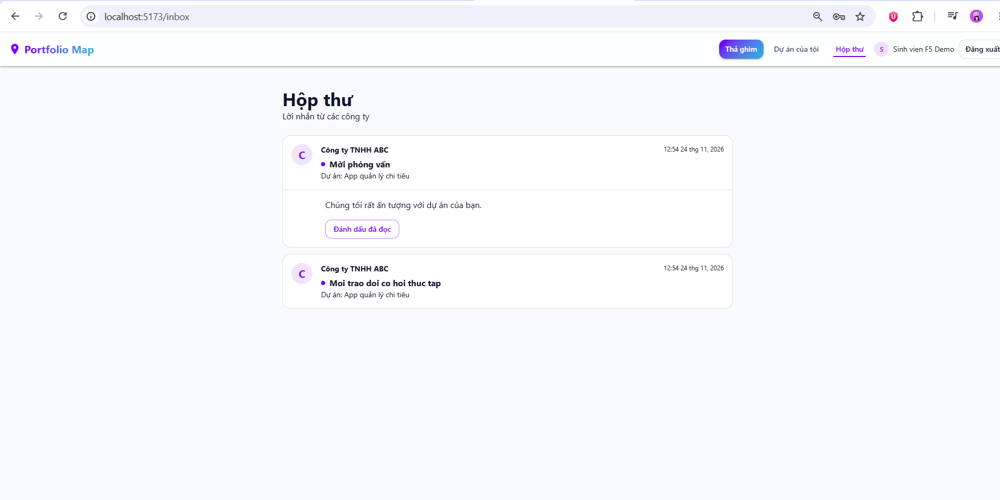

# Báo cáo chức năng F5 — Kết nối Doanh nghiệp và Sinh viên

## 1. Tổng quan

Chức năng F5 hỗ trợ Doanh nghiệp và Sinh viên kết nối qua các dữ liệu dự án trên Portfolio Map:

- Doanh nghiệp xem và cập nhật hồ sơ công ty công khai.
- Doanh nghiệp lưu các dự án quan tâm và xem danh sách dự án đã lưu.
- Doanh nghiệp gửi lời nhắn tới chủ sinh viên của một dự án.
- Sinh viên nhận lời nhắn trong hộp thư đến và đánh dấu thư đã đọc.

Dữ liệu F5 được lưu trong cơ sở dữ liệu bằng EF Core; các API không sử dụng dữ liệu mẫu mock.

## 2. Luồng hoạt động

### 2.1. Luồng Doanh nghiệp lưu dự án và gửi lời nhắn



Doanh nghiệp có thể xem lại hồ sơ công ty công khai bằng `GET /api/companies/{id}` hoặc cập nhật hồ sơ của chính mình bằng `PUT /api/companies/me`.

### 2.2. Luồng Sinh viên nhận và đọc lời nhắn

```mermaid
flowchart TD
    A[Sinh viên đăng nhập] --> B[Mở trang Hộp thư]
    B --> C[GET /api/contacts/inbox]
    C --> D[API truy vấn thư theo ToUserId]
    D --> E[Map dữ liệu công ty, người nhận và dự án]
    E --> F[Hiển thị danh sách thư mới nhất]
    F --> G{Sinh viên mở thư?}
    G -->|Có| H[Xem tiêu đề, công ty, dự án và nội dung]
    H --> I[Nhấn Đánh dấu đã đọc]
    I --> J[PUT /api/contacts/{id}/read]
    J --> K[API kiểm tra thư và quyền người nhận]
    K -->|Không phải thư của sinh viên| L[403 Forbidden]
    K -->|Thư tồn tại và hợp lệ| M[IsRead = true]
    M --> N[204 No Content]
    G -->|Không| O[Giữ nguyên trạng thái]
```

## 3. Danh sách API F5

### 3.1. Nhóm Companies

| STT | Method | Endpoint | Role yêu cầu | Mô tả chức năng | Request Body / Query Params | Response Status Codes |
|---:|---|---|---|---|---|---|
| 1 | GET | `/api/companies/{id}` | Public; không yêu cầu đăng nhập | Lấy hồ sơ công ty theo `UserId` | Path: `id` — chuỗi `UserId` | 200 `CompanyProfileDto`; 404 `ApiErrorResponse` |
| 2 | PUT | `/api/companies/me` | `Company` | Upsert hồ sơ công ty của tài khoản hiện tại; chuỗi đầu vào được trim | Body: `companyName`, `website`, `address`, `description`, `logoUrl` | 200 `CompanyProfileDto`; 400, 401, 403, 404 `ApiErrorResponse` |

**Request cập nhật hồ sơ công ty:**

```json
{
  "companyName": "Công ty Công nghệ Đà Nẵng",
  "website": "https://example.com",
  "address": "Hải Châu, Đà Nẵng",
  "description": "Mô tả công ty",
  "logoUrl": null
}
```

**Response mẫu `CompanyProfileDto`:**

```json
{
  "id": "company-user-id",
  "companyName": "Công ty Công nghệ Đà Nẵng",
  "website": "https://example.com",
  "address": "Hải Châu, Đà Nẵng",
  "description": "Mô tả công ty",
  "logoUrl": null
}
```

### 3.2. Nhóm SavedProjects

| STT | Method | Endpoint | Role yêu cầu | Mô tả chức năng | Request Body / Query Params | Response Status Codes |
|---:|---|---|---|---|---|---|
| 1 | POST | `/api/saved-projects/{projectId}` | `Company` | Lưu dự án quan tâm cho công ty hiện tại | Path: `projectId` dạng `int` | 201 `{ projectId, savedAt }`; 401, 403, 404, 409 `ApiErrorResponse` |
| 2 | DELETE | `/api/saved-projects/{projectId}` | `Company` | Bỏ lưu dự án đã lưu | Path: `projectId` dạng `int` | 204; 401, 403, 404 `ApiErrorResponse` |
| 3 | GET | `/api/saved-projects` | `Company` | Lấy danh sách dự án đã lưu, mới lưu lên đầu | Query: `page=1`, `pageSize=10`; `pageSize` được giới hạn từ 1 đến 50 | 200 `PagedResult<SavedProjectDto>`; 401, 403 `ApiErrorResponse` |

Cấu trúc phân trang:

```json
{
  "items": [],
  "page": 1,
  "pageSize": 10,
  "totalItems": 0
}
```

### 3.3. Nhóm Contacts

| STT | Method | Endpoint | Role yêu cầu | Mô tả chức năng | Request Body / Query Params | Response Status Codes |
|---:|---|---|---|---|---|---|
| 1 | POST | `/api/contacts` | `Company` | Gửi lời nhắn tới chủ dự án; không nhận `fromUserId` hoặc `toUserId` từ client | Body: `projectId`, `subject`, `content` | 201 `{ id, createdAt }`; 400, 401, 403, 404 `ApiErrorResponse` |
| 2 | GET | `/api/contacts/inbox` | `Student` | Lấy hộp thư đến của sinh viên hiện tại, thư mới nhất trước | Query: `page=1`, `pageSize=10`; `pageSize` được giới hạn từ 1 đến 50 | 200 `PagedResult<ContactDto>`; 401, 403 `ApiErrorResponse` |
| 3 | GET | `/api/contacts/sent` | `Company` | Lấy thư do công ty hiện tại đã gửi, thư mới nhất trước | Query: `page=1`, `pageSize=10`; `pageSize` được giới hạn từ 1 đến 50 | 200 `PagedResult<ContactDto>`; 401, 403 `ApiErrorResponse` |
| 4 | PUT | `/api/contacts/{id}/read` | `Student` | Đánh dấu thư là đã đọc; chỉ người nhận mới được thao tác | Path: `id` dạng `int` | 204; 401, 403, 404 `ApiErrorResponse` |

**Request gửi lời nhắn:**

```json
{
  "projectId": 1,
  "subject": "Mời trao đổi cơ hội thực tập",
  "content": "Chúng tôi muốn tìm hiểu thêm về dự án của bạn."
}
```

## 4. Thiết kế cơ sở dữ liệu

### 4.1. Bảng `SavedProjects`

Khóa chính tổng hợp gồm `UserId` và `ProjectId`. Mỗi cặp công ty/dự án chỉ được lưu một lần.

| Tên cột | Kiểu dữ liệu | Ràng buộc | Mô tả ý nghĩa |
|---|---|---|---|
| `UserId` | `nvarchar(450)` tương ứng `string` trong Entity | PK, FK tới `AspNetUsers.Id`, không nullable, `DeleteBehavior.Restrict` | Định danh công ty đã lưu dự án |
| `ProjectId` | `int` | PK, FK tới `Projects.Id`, không nullable, `DeleteBehavior.Cascade` | Dự án được công ty lưu |
| `SavedAt` | `datetime2` | Không nullable; mặc định giá trị tạo trong Entity là `DateTime.UtcNow` | Thời điểm lưu dự án |

Quan hệ khóa:

- `SavedProjects.UserId -> AspNetUsers.Id`: khóa ngoại, không cho xóa người dùng theo cách cascade.
- `SavedProjects.ProjectId -> Projects.Id`: khóa ngoại, xóa dự án sẽ xóa các bản ghi lưu tương ứng (`Cascade`).

### 4.2. Bảng `ContactMessages`

| Tên cột | Kiểu dữ liệu | Ràng buộc | Mô tả ý nghĩa |
|---|---|---|---|
| `Id` | `int` | PK, Identity, không nullable | Mã định danh lời nhắn |
| `FromUserId` | `nvarchar(450)` tương ứng `string` trong Entity | FK tới `AspNetUsers.Id`, không nullable, `DeleteBehavior.Restrict`; index FK do EF Core tạo theo quy ước | Công ty gửi lời nhắn |
| `ToUserId` | `nvarchar(450)` tương ứng `string` trong Entity | FK tới `AspNetUsers.Id`, không nullable, `DeleteBehavior.Restrict`; index cấu hình tường minh `IX_ContactMessages_ToUserId` | Sinh viên nhận lời nhắn |
| `ProjectId` | `int?` | Nullable, FK tới `Projects.Id`, `DeleteBehavior.SetNull`; index FK do EF Core tạo theo quy ước | Dự án liên quan; có thể mất liên kết nếu dự án bị xóa |
| `Subject` | `nvarchar(200)` | Không nullable, `MaxLength(200)`, `IsRequired()` | Tiêu đề lời nhắn |
| `Content` | `nvarchar(2000)` | Không nullable, `MaxLength(2000)`, `IsRequired()` | Nội dung lời nhắn |
| `IsRead` | `bit` | Không nullable | Trạng thái đã đọc (`true`) hay chưa đọc (`false`) |
| `CreatedAt` | `datetime2` | Không nullable; mặc định giá trị tạo trong Entity là `DateTime.UtcNow` | Thời điểm gửi lời nhắn |

Quy tắc khóa ngoại:

- Gửi hoặc nhận thư không được tự động cascade khi người dùng bị xóa; quan hệ `FromUserId` và `ToUserId` dùng `DeleteBehavior.Restrict`.
- Khi dự án bị xóa, `ContactMessages.ProjectId` được đặt `NULL` thay vì xóa toàn bộ lời nhắn nhờ `DeleteBehavior.SetNull`.
- Khi đó lịch sử lời nhắn vẫn còn, còn `projectId` và `projectTitle` trong `ContactDto` được trả về `null`.

## 5. Minh họa giao diện thực tế

### 5.1. Hồ sơ công ty và danh sách dự án đã lưu



### 5.2. Doanh nghiệp gửi lời nhắn kết nối sinh viên



### 5.3. Hộp thư đến của sinh viên


